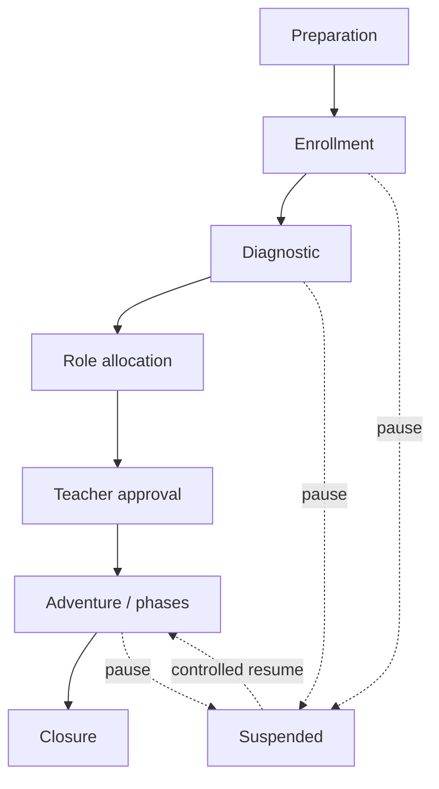

<!-- Frozen source: https://github.com/Rejean-McCormick/Kompose/wiki/Capsule-Journey | commit: ec94ee500739b0078a14ee9cf67d34d46d2087e4 | SHA-256: 8afd7fcee800743d8d1ccdabcf63303e7aadc1b84f8e8de6840a7757534fec52 -->

# Capsule Journey — Proposed Experience, Not a Live School Session

> This is the **future classroom design**, not deployed functionality. Real Tandem tasks and workflow transitions belong exclusively to **Orgo** under ADR 0008; KOMPOSE provides only local state simulations and planning previews.

## Before admission

A teacher selects a versioned capsule, configures roles and capacities, diagnostic settings, casting policy, accessibility needs, and private pedagogical constraints. Documentary sources undergo their own review.

## Student journey

1. Open the Entry Door on a Chromebook or tablet and join using a session code **and** an authorized school identity.
2. Explore the public role descriptions.
3. Complete an adaptive diagnostic with recovery after interrupted connectivity.
4. Depending on session policy, select an available role when eligible or receive a proposed assignment.
5. Wait for the teacher to approve the complete assignment before publication.
6. Receive personalized missions and events through a client interface.
7. Discover or obtain access to Kristals; contact a guardian when the story requires it.
8. Compare sources, complete missions, and contribute to the group's synthesis.
9. Close the adventure and review appropriate learning feedback.

The diagram simplifies recovery: the controller preserves the **previous state** and resumes in the corresponding phase, not automatically in the adventure phase. See `src/kompose/lifecycle.py` and `docs/02-parcours.md`.

## Interruptions, absences, and deadlocks

- Expired code: deny access without unnecessary disclosure; teacher can generate a new code.
- Absent student: controlled resumption or teacher-managed manual assignment.
- Non-comparable diagnostic scores: skip ranking and use guided selection.
- No valid casting solution: never publish an assignment that breaks safety rules.
- Absent guardian: supervised transfer or an alternative access route.
- Blocked mission: inspect prerequisites and provide pedagogically appropriate alternatives.

[[Home|← Home]] · [[Missions-and-Events|Orchestration →]]
