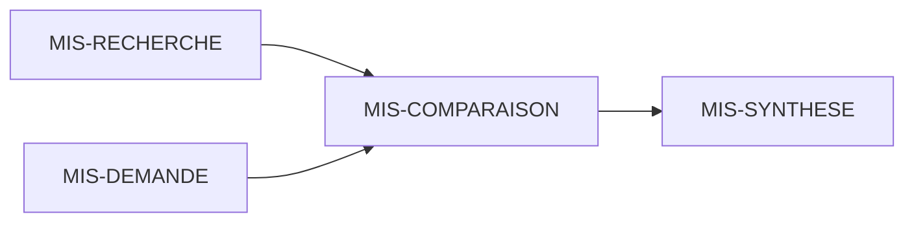

<!-- Frozen source: https://github.com/Rejean-McCormick/Kompose/wiki/Rivers-Demo-Capsule | commit: ec94ee500739b0078a14ee9cf67d34d46d2087e4 | SHA-256: 12af95e797769f8869b75603c453fd044ebce5daad9b73dccd2b5edd2ba4724e -->

# “Rivers” Demonstration Capsule

**Fictional data.** The characters, territories, documents, and narratives do **not represent real historical events**. The content must not be distributed as “verified knowledge.”

## Files

All artifacts are located in `examples/capsule-rivieres/`:

| File | Description |
|---|---|
| `capsule.json` | Capsule definition |
| `roles.json` | **20 roles**, including capacities, goals, and links |
| `diagnostic.json` | Mock diagnostic blueprint |
| `missions.json` | **4 missions** and dependencies |
| `phases.json` | Shared progression phases |
| `kristals.json` | **2 fictional Kristals** |
| `prompts.json` | Event-triggered prompt definitions |
| `session.example.json` | Fictional session with 20 participants |
| `allocation.preview.example.json` | Non-operational allocation illustration |
| `teacher-constraints.PRIVE-DEMO.json` | Strictly fictional example of private constraints |

## Example narrative thread

A Cartographer examines representations; an Archivist distinguishes sources from interpretations; Messengers and mediators facilitate Kristal access. The group compares the limits of multiple records instead of selecting a “truth” by majority vote.

### Example dependencies



## Run the example

```bash
PYTHONPATH=src python3 -m kompose.cli validate examples/capsule-rivieres
PYTHONPATH=src python3 -m kompose.cli demo-flow examples/capsule-rivieres
PYTHONPATH=src python3 -m kompose.cli quota 20
```

Example data illustrate mechanics; they **do not** validate the adaptive algorithm, assignment fairness, or historical conclusions.

[[Home|← Home]] · [[Quick-Start|Get started →]]
