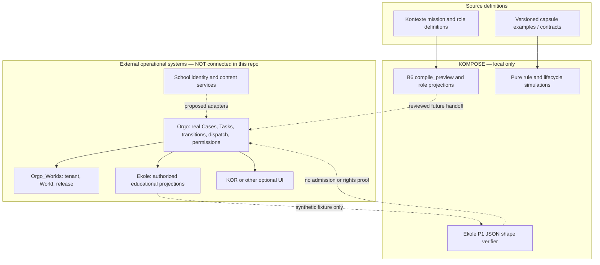

<!-- Frozen source: https://github.com/Rejean-McCormick/Kompose/wiki/Architecture | commit: ec94ee500739b0078a14ee9cf67d34d46d2087e4 | SHA-256: a1e9e7bb316bb0132635747d0409ac36daa428ce2e44639a397769cd8eff2b79 -->

# Architecture — Source of Truth and Operational Boundaries

## Implemented vs. proposed

KOMPOSE is a standalone **design, validation, and simulation reference**. Its pure Python functions model educational session states and dependencies; **they do not manage real Tandem operations**. KOR remains an optional client application, and Orgo remains the sole operational authority. See source ADRs **0006** and **0008**.

**No arrow above labelled as a proposed or fixture-based connection is a deployed API integration.**

## Source modules

| Local module | Implemented role | Explicit limit |
|---|---|---|
| `lifecycle.py`, `coordination.py`, `entry.py` | Pure demonstration transitions, prerequisites, join checks, dependencies and guardian-transfer proposals | No persistence, IAM, or Orgo operations |
| `reader.py`, `events.py`, `validation.py` | Deterministic, synthetic document lookup, prompt selection, capsule checks | No real content approvals or audience service |
| `kontexte_preview.py` | B6 non-executable preview, role projection and fallback proposal | Never assigns students, remaps course IDs or creates Cases/Tasks |
| `mission_replay.py` | Ordered, idempotent **fictional** Orgo receipt replay | Fixture assertions are not signed teacher approval |
| `tandem_handoff.py` | Strict Ekole P1 JSON file shape verifier | No permission, WorldRelease, identity, or operational admission check |
| `cli.py` | Local access to the demonstrators | No server |

## Proposed ports, not installed adapters

The design discusses identity, diagnostics, role allocation, source content, persistence, audit, presentation, and events. The **OpenAPI `/v1` routes are specifications, not endpoints**. A future adapter must document who owns each operation and its authorization, tenancy, versioning, and rollback checks.

## Authority matrix

| Data/operation | Canonical authority | KOMPOSE role |
|---|---|---|
| Kontexte scenario definitions | Kontexte | Local validation and safe plan preview |
| Real operational Case / Task / Signal | **Orgo** | No mutation |
| Tenant, World, WorldRelease | Orgo_Worlds / authoritative services | Syntax only in P1 fixtures |
| Teacher-facing learning projection | Ekole / authorized school services | Synthetic preview format check |
| Narrative rendering | KOR or another authorized client | Optional example manifest only |
| Editorially approved Kristals | Content/editorial authority | Local demo reader and contract rules |

[[Home|← Home]] · [[Tandem-Orgo-Boundary|Boundary details]] · [[API-and-Contracts|Contracts →]]
