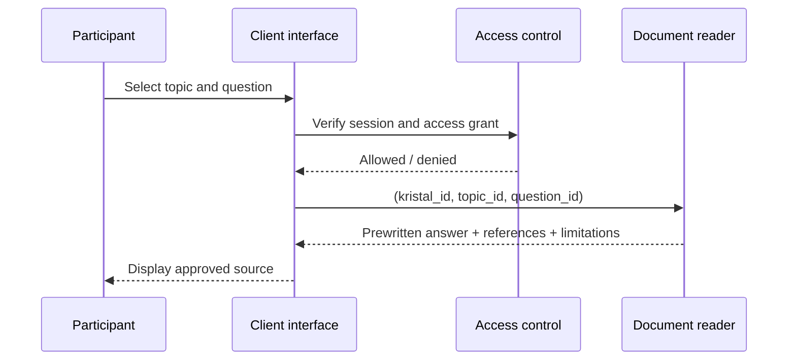

<!-- Frozen source: https://github.com/Rejean-McCormick/Kompose/wiki/Kristals | commit: ec94ee500739b0078a14ee9cf67d34d46d2087e4 | SHA-256: b3d5de24d7c3ec61418f6601dc0001d45dacaddbe526529b73b15bb4c866646d -->

# Kristals — Making Knowledge Playable

A **Kristal** is a **structured, versioned collection of documents**, including sources, an explicitly attributed perspective, guided questions, and approved answers. It is not an AI, a character, or context-free truth.

## Kristal ≠ guardian ≠ access

| Concept | Meaning |
|---|---|
| `Kristal` | Stable, versioned editorial knowledge |
| `Custody` | Temporary guardianship assigned to a session participant |
| `AccessGrant` | Authorization to read, scoped to a requester, session, and Kristal |

A guardian can facilitate encounters or transfer knowledge, but must never invent answers or permanently prevent access to learning content.

## Narrative acquisition

- **Entrusted:** a challenge, rotation, or teacher decision assigns guardianship.
- **Discovered:** an investigation or clue makes a Kristal accessible.
- **Transferred:** a seeker meets a guardian and receives authorized access.
- **Reconstructed:** combining evidence unlocks further reading.

The mechanic needs alternatives for absent guardians, isolated students, delays, inaccessible devices, and assisted access.

## Reading without AI

The reader uses **no generative AI**; it selects only pre-approved documentary answers.

The answer is bound **exactly to the identifiers** `(kristal_id, topic_id, question_id)` and the approved version. The system never improvises an answer for an unknown question. Local CLI access simulation is not a substitute for production authorization.

## Historical perspectives

Perspectives are attributed to **specific authors, organizations, and named Indigenous nations** where relevant. “Colonists” and “Indigenous peoples” must not be reduced to two homogeneous sides or assumed to have automatically equivalent claims. Distinguish documented facts, testimonies, interpretation, uncertainty, and publication rights. Community review and cultural protocols apply where appropriate.

## Publication workflow

Draft → review → approved publication → possible retirement. Any correction produces a **new version**; sessions pin accessible versions. The example capsule's Kristals have `status: demo` and are not verified historical sources.

[[Home|← Home]] · [[Editorial-Governance|Editorial policy →]] · [[Rivers-Demo-Capsule|Example →]]
