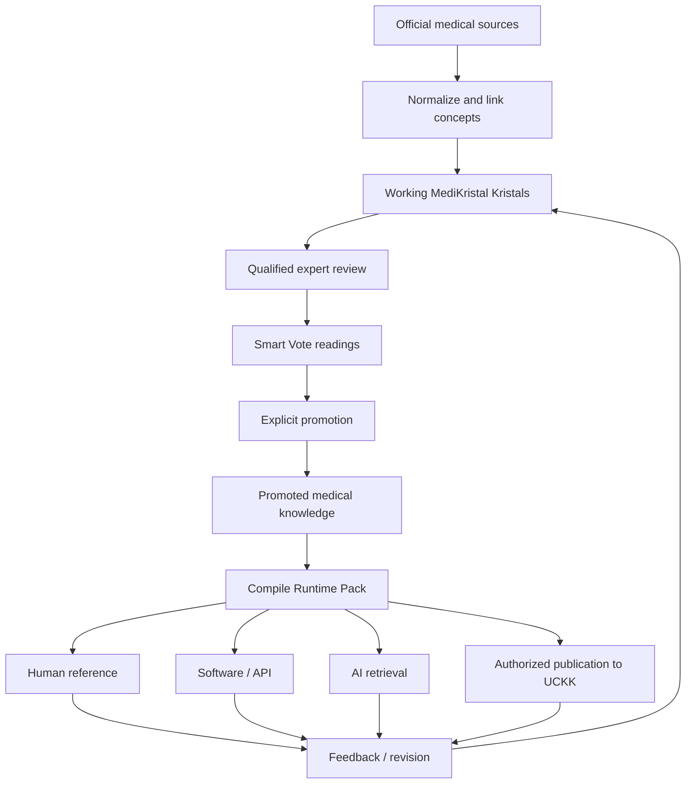

<!-- Frozen source: https://github.com/Rejean-McCormick/MediKristal/wiki/Home | commit: 93fba2ff54b0d2066bc5f3ba8afecf16ec10590c | SHA-256: 0c1be55cbbab21e6d3e66bbf2cdde02c96a55433ff91e0e6d4d6f99b6e321638 -->

# MediKristal

> **MediKristal is a governed, multilingual medical knowledge system: a living reference work in which medical knowledge is formalized as traceable, versioned, machine-readable Kristal artifacts.**

MediKristal is **not an AI doctor**. It does not ask a language model to invent medicine from memory. Its purpose is to organize existing medical knowledge so that humans, conventional software, and AI systems can consult the **same governed corpus**.

## The idea in one view



The medical corpus begins with sources that already exist:

- **SNOMED CT / SNOMED CT CA** — symptoms, findings, procedures, clinical concepts;
- **ICD-11** — diseases and diagnostic classification;
- **LOINC / pCLOCD** — tests, measurements, observations;
- **CCDD + Health Canada Drug Product Database (DPD)** — Canadian medication concepts and authorized products;
- **RxNorm** — normalized medication identifiers and cross-system interoperability;
- **WHO, NICE, CDC, Canadian, provincial, and institutional guidelines** — recommendations and protocols;
- **CQL / FHIR Clinical Reasoning** — future machine-readable clinical logic.

MediKristal does not replace these sources. It **orchestrates them while preserving where every claim came from**.

## The five medical layers

```text
Patient context
      ↓ modifies
Symptoms / signs ↔ Conditions ↔ Tests ↔ Treatments
                         ↕
                 Guidelines / protocols
```

Patient context is kept separate from medical knowledge. Age, allergies, pregnancy, current medications, geography, organ function, and risk factors modify applicability; they are not themselves medical doctrine.

## The role of Kristal

A **Kristal** is the portable knowledge artifact used to carry a medical assertion together with the information needed to interpret it responsibly: provenance, versions, uncertainty, scope, semantic relations, validation state, and reader policy.

MediKristal uses Kristals so that a medical statement is not just an anonymous database row.

```text
claim
+ source
+ source version
+ jurisdiction
+ applicability
+ status
+ review history
+ language representations
= inspectable medical knowledge artifact
```

See [[Kristal Lifecycle in MediKristal]].

## The role of kOA-Linux

[kOA-Linux](https://github.com/Rejean-McCormick/kOA-Linux/wiki) is the **sovereign operating environment** around this knowledge lifecycle.

It provides the controlled local environment in which MediKristal tools can:

- ingest and stage source data;
- modify and compile working Kristals;
- run schema, provenance, and conformance checks;
- apply identity, trust, and policy boundaries;
- activate, pin, update, and roll back Runtime Packs;
- continue offline;
- preserve audit evidence;
- control import and publication boundaries, including publication toward UCKK.

kOA-Linux does **not** decide what is medically true. The medical authority remains in sources, qualified review, declared governance, and explicit promotion.

See [[MediKristal on kOA-Linux]].

## The role of Smart Vote

MediKristal is intended to evolve through professional review. Smart Vote is not a public popularity vote and does not let an AI promote its own output.

For a medical change, eligibility is tied to **verified relevant competence**: physicians, pharmacists, laboratory specialists, nurses, epidemiologists, terminology experts, or other certified professionals according to the domain under review.

```text
candidate change
→ evidence
→ eligible expert review
→ reproducible Smart Vote reading
→ explicit promotion decision
→ new governed version
```

See [[Governance and Smart Vote]].

## Multilingual by structure

MediKristal separates medical meaning from wording.

```text
Validated medical meaning
          ↓
Structured representation
          ↓
Language-specific realization
```

The same governed knowledge can therefore be rendered in French, English, or another supported language without requiring a generative AI to recreate the underlying meaning.

See [[Multilingual Model]].

## AI is a reader, not the corpus

An AI may query MediKristal, explain a result, compare versions, or help a reviewer inspect evidence. But the AI does not own the medical corpus and cannot silently promote new medical knowledge.

```text
Question → AI/interface → MediKristal query → governed result + provenance → explanation
```

See [[AI and MediKristal]].

## UCKK is a distribution surface

[UCKK](https://uckk.org) can distribute authorized representations of MediKristal knowledge for learning and reference. The canonical MediKristal/Kristal state remains distinct from the published UCKK object.

The kOA-Linux boundary already defines the explicit model:

```text
publish_to_uckk
import_from_uckk
```

There is no hidden database merge or automatic synchronization of authority.

See [[Distribution through UCKK]].

## Current status

MediKristal remains an **early foundational architecture**. The immediate objective is not to import all of medicine. It is to prove one small medical domain end-to-end:

```text
source
→ normalization
→ working Kristal
→ expert review
→ promotion
→ Runtime Pack
→ multilingual query
→ human/software/AI use
→ traceable revision
```

## Start here

- [[What MediKristal Is]]
- [[MediKristal on kOA-Linux]]
- [[Medical Source Orchestration]]
- [[Kristal Lifecycle in MediKristal]]
- [[Semantic Medical Graph]]
- [[Governance and Smart Vote]]
- [[Multilingual Model]]
- [[AI and MediKristal]]
- [[Distribution through UCKK]]
- [[Related Systems and Links]]
