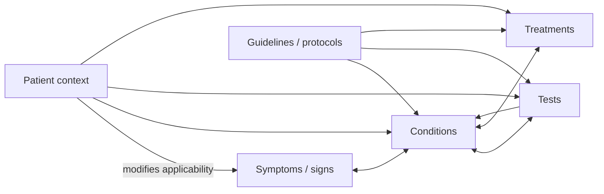

<!-- Frozen source: https://github.com/Rejean-McCormick/MediKristal/wiki/Semantic-Medical-Graph | commit: 93fba2ff54b0d2066bc5f3ba8afecf16ec10590c | SHA-256: 661efa19e909e97b1e6d3db638d594ed60bdb66c00b81767abc2b97b8631fe4a -->

# Semantic Medical Graph

MediKristal represents medicine as explicit relationships between independently governed objects.

## Core graph



## Five domain layers

### Patient context

Patient-specific facts that modify applicability:

- age;
- sex;
- pregnancy status;
- allergies;
- known conditions;
- current medications;
- kidney/liver function;
- geography/jurisdiction;
- travel;
- risk factors.

### Symptoms and signs

Reported or observed clinical phenomena.

### Diseases and diagnoses

Conditions, syndromes, differential possibilities, complications, exclusions, and classifications.

### Tests and investigations

Laboratory tests, measurements, imaging, procedures, indications, limits, and interpretation rules.

### Medications and treatments

Drugs, formulations, dose concepts, contraindications, interactions, adjustments, and non-drug interventions.

## Assertions, not anonymous edges

A graph relation should carry its epistemic context.

```json
{
  "assertion_id": "assertion:pneumonia-fever-001",
  "subject": "condition:pneumonia",
  "predicate": "has_common_symptom",
  "object": "symptom:fever",
  "scope": {
    "jurisdiction": "CA-QC",
    "population": "adult"
  },
  "status": "under_review",
  "provenance": ["source:guideline-example"],
  "review_refs": []
}
```

The semantic relation and the epistemic state remain linked.

## Useful predicates

```text
has_symptom
may_indicate
risk_increased_by
recommended_test
measured_by
supports_diagnosis
argues_against
contraindicated_if
interacts_with
requires_dose_adjustment_if
recommended_treatment
urgent_if
applies_in_jurisdiction
supported_by
supersedes
```

## Concept identity versus labels

A single medical concept may have:

- a MediKristal identity;
- a SNOMED CT code;
- an ICD-11 classification;
- LOINC or drug mappings;
- French and English labels;
- local aliases;
- historical identifiers.

MediKristal should distinguish **what the concept is** from **how a system names or classifies it**.

## Query principle

A MediKristal query should ideally return not only an answer but the path supporting it.

Examples:

- Which conditions are associated with this symptom cluster?
- Which red flags apply in this patient context?
- Which tests are recommended by a named protocol?
- Which medication is contraindicated by this allergy or organ impairment?
- Which source/version justifies the relation?
- Which relations changed between two releases?

```text
result
+ semantic path
+ source chain
+ applicability
+ status
+ release identity
```
