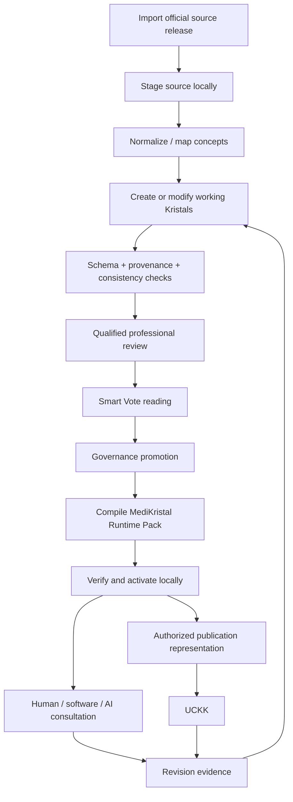

<!-- Frozen source: https://github.com/Rejean-McCormick/MediKristal/wiki/MediKristal-on-kOA-Linux | commit: 93fba2ff54b0d2066bc5f3ba8afecf16ec10590c | SHA-256: e539e0ff983f39f7e6e3e66e78ec29bc662cac858331b0c1175dd89f39389d6b -->

# MediKristal on kOA-Linux

MediKristal defines a medical knowledge domain. **kOA-Linux provides the sovereign operating environment in which that knowledge can be worked on, validated, activated, used locally, and published through controlled boundaries.**

- [kOA-Linux Wiki](https://github.com/Rejean-McCormick/kOA-Linux/wiki)
- [What kOA-Linux does](https://github.com/Rejean-McCormick/kOA-Linux/wiki/What-kOA-Linux-Does)
- [kOA-Linux responsibilities](https://github.com/Rejean-McCormick/kOA-Linux/wiki/kOA-Linux-Responsibilities)
- [Knowledge-to-action loop](https://github.com/Rejean-McCormick/kOA-Linux/wiki/Knowledge-to-Action-Loop)

## Separation of responsibilities

| Layer | Responsibility |
|---|---|
| **MediKristal** | medical source orchestration, medical graph, assertions, protocols, domain governance |
| **Kristal Framework** | portable knowledge artifacts, provenance, status, versions, validation state, reader policy |
| **kOA-Linux** | local execution, isolation, verification, activation, policy, offline operation, recovery, controlled publication |
| **SenTient** | optional extraction/reconciliation of candidate structured knowledge from unstructured material |
| **SemantiK Architect** | deterministic multilingual realization of structured meaning |
| **Konnaxion / Smart Vote** | competence-aware participation, deliberation, learning, governance surfaces |
| **UCKK** | external online learning/publication environment and Mediatheque |

The OS is therefore **not the medical authority** and is not the entire Kristal authoring system. It is the environment that can safely host and coordinate the tools that modify and compile Kristals.

## A MediKristal workstation flow

A kOA-Linux installation can conceptually support this workflow:



## What “modify a Kristal” means here

A working medical Kristal may be changed because:

- a new terminology release adds or retires a concept;
- a guideline changes;
- a drug product changes market status;
- a mapping is discovered to be wrong;
- a French/English terminology mapping is improved;
- new evidence changes certainty or applicability;
- an institutional protocol changes;
- expert review identifies a conflict or missing qualification.

The modification remains a **working change** until the relevant governance process promotes it.

```text
edit / compile ≠ approve
```

## What kOA-Linux contributes

The kOA-Linux architecture supplies host-level controls around this process:

- **local execution** — the knowledge system can operate on a local node;
- **identity and trust** — reviewer and operator actions can be bounded by identity and policy;
- **verified activation** — only declared/verified artifacts are activated;
- **version pinning** — a node can remain on a known knowledge release;
- **rollback / recovery** — a failed update does not silently replace the current verified state;
- **offline continuity** — Runtime Packs can remain usable without a live cloud dependency;
- **audit boundaries** — important transitions can produce receipts/evidence;
- **controlled external integration** — import/publication is explicit rather than an invisible database merge.

See also:

- [Portable Knowledge with Kristal](https://github.com/Rejean-McCormick/kOA-Linux/wiki/Portable-Knowledge-with-Kristal)
- [Release and Artifact Lifecycle](https://github.com/Rejean-McCormick/kOA-Linux/wiki/Release-and-Artifact-Lifecycle)
- [Conformance and Validation](https://github.com/Rejean-McCormick/kOA-Linux/wiki/Conformance-and-Validation)
- [Offline-First Operation](https://github.com/Rejean-McCormick/kOA-Linux/wiki/Offline-First-Operation)

## Why this matters in medicine

Medical knowledge changes continuously, but clinical environments need reproducibility.

A hospital should be able to know:

```text
Which MediKristal release was active?
Which source versions were inside it?
Which protocol version ran?
Which language pack rendered the result?
Who promoted that release?
What changed afterward?
```

kOA-Linux provides the operating conditions needed to make that kind of historical reconstruction possible.
