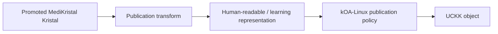

<!-- Frozen source: https://github.com/Rejean-McCormick/MediKristal/wiki/Distribution-through-UCKK | commit: 93fba2ff54b0d2066bc5f3ba8afecf16ec10590c | SHA-256: 344a0b93fb1a2740239459ea47b5f37a1556ea67fae331496d4c552933db659d -->

# Distribution through UCKK

[UCKK](https://uckk.org) is an external online learning and publication environment in the wider kOA ecosystem. In the current kOA-Linux architecture, it is **not an internal MediKristal database and not the canonical authority for Kristal knowledge**.

- [UCKK in the kOA-Linux Wiki](https://github.com/Rejean-McCormick/kOA-Linux/wiki/UCKK)
- [kOA and UCKK Mediatheques](https://github.com/Rejean-McCormick/kOA-Linux/wiki/UCKK-Mediatheque)
- [Global Communications and Distribution](https://github.com/Rejean-McCormick/kOA-Linux/wiki/Global-Communications-and-Distribution)

## Why publish MediKristal knowledge to UCKK?

MediKristal can provide structured, governed medical knowledge. UCKK can provide a human-facing distribution and learning surface.

Possible published representations include:

- medical reference cards;
- multilingual patient education resources;
- professional learning modules;
- versioned guideline summaries;
- diagrams and knowledge pathways;
- quizzes or competence-learning material derived from approved knowledge;
- public-health information packages;
- Mediatheque resources linked to their source/provenance.

## The publication boundary

The kOA-Linux model defines an explicit operation:

```text
publish_to_uckk
```

For MediKristal, the safe conceptual model is:



The published UCKK object is a **representation derived from** a MediKristal knowledge state. It does not silently become the canonical Kristal.

## Preserve publication provenance

A published representation should carry enough metadata to reconnect it to the source knowledge state:

```text
MediKristal artifact/release ID
source knowledge version
publication date
language
jurisdiction / audience
publication transformation version
rights / restrictions
supersession status
```

If the MediKristal source is later revoked or superseded, UCKK should be able to identify the affected published object.

## Import is also explicit

The kOA-Linux model also provides:

```text
import_from_uckk
```

A selected UCKK resource can therefore be imported as a **distinct local copy or candidate input**. It should not be silently merged into the canonical MediKristal corpus.

```text
UCKK resource
→ imported local object
→ provenance preserved
→ optional candidate extraction/review
→ only then possible Kristal change
```

## No hidden synchronization

There should be no generic operation equivalent to:

```text
sync_everything_and_merge_authority
```

MediKristal, local kOA data, and UCKK retain separate databases, identities, authorities, and lifecycles.

## Medical publication safety

For medical material, a UCKK representation should make visible when relevant:

- source/release identity;
- date/version;
- jurisdiction;
- intended audience;
- educational/reference purpose;
- whether the content is superseded;
- whether the material is validated for clinical use or only research/prototyping.

Distribution expands access; it must not erase the governance that made the information trustworthy.
