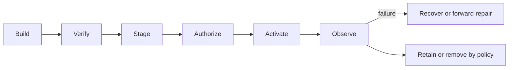

<!-- Frozen source: https://github.com/Rejean-McCormick/kOA-Linux-Koali/wiki/Release-and-Artifact-Lifecycle | commit: a014d6b410b475fe227e3f0153bbae6e54ef0520 | SHA-256: 288f16b07de2ea85baf42e6cd2c6346564693229b62fa8abc6c1280dfe0ce57d -->

<!-- Navigational projection. Normative authority remains in the repository docs/ corpus. -->

# Release and Artifact Lifecycle

> **Authority notice:** This wiki is a readable navigation layer. Source contracts, accepted ADRs, normative documents, and executable validators in the repository remain authoritative.

## Lifecycle model

Artifacts are identified, verified, staged, activated, observed, recovered, retained, and removed through declared contracts. Activation is atomic or otherwise fail-safe for the applicable artifact class.

An activation failure leaves the current verified release active. Recovery restores the latest verified release as one unit; it does not activate an undeclared operating mode.

## Core lifecycle stages

## Artifact contracts

| Artifact or exchanged object | Schema |
| --- | --- |
| kOA Cultural Rights Policy Artifact | [schema](../blob/main/docs/contracts/artifact-contracts/cultural-rights-policy.schema.json) |
| kOA Decision Receipt | [schema](../blob/main/docs/contracts/artifact-contracts/decision-receipt.schema.json) |
| kOA Developer Workspace Manifest | [schema](../blob/main/docs/contracts/artifact-contracts/developer-workspace.schema.json) |
| kOA Integration Manifest Schema | [schema](../blob/main/docs/contracts/artifact-contracts/integration-manifest.schema.json) |
| kOA Language Runtime Pack Artifact Contract | [schema](../blob/main/docs/contracts/artifact-contracts/language-pack.schema.json) |
| kOA Node Profile Artifact | [schema](../blob/main/docs/contracts/artifact-contracts/node-profile.schema.json) |
| kOA Offline Bundle | [schema](../blob/main/docs/contracts/artifact-contracts/offline-bundle.schema.json) |
| kOA Governance Policy Bundle | [schema](../blob/main/docs/contracts/artifact-contracts/policy-bundle.schema.json) |
| kOA Provenance Receipt | [schema](../blob/main/docs/contracts/artifact-contracts/provenance-receipt.schema.json) |
| kOA Publication Receipt | [schema](../blob/main/docs/contracts/artifact-contracts/publication-receipt.schema.json) |
| kOA Publication Request | [schema](../blob/main/docs/contracts/artifact-contracts/publication-request.schema.json) |
| kOA Release Set | [schema](../blob/main/docs/contracts/artifact-contracts/release-set.schema.json) |
| kOA Resource Envelope | [schema](../blob/main/docs/contracts/artifact-contracts/resource-envelope.schema.json) |
| kOA Runtime Pack | [schema](../blob/main/docs/contracts/artifact-contracts/runtime-pack.schema.json) |
| kOA Sovereignty Bundle Schema | [schema](../blob/main/docs/contracts/artifact-contracts/sovereignty-bundle.schema.json) |
| kOA Workspace Port Allocation | [schema](../blob/main/docs/contracts/artifact-contracts/workspace-port-allocation.schema.json) |

## Release controls

- release channels are independently versioned;
- a release set pins compatible identities;
- signatures, provenance, SBOM, compatibility, policy, and evidence are checked before activation;
- offline bundles preserve verification and admission rules;
- data schema evolution and contract removal remain explicit;
- forward repair is preferred when rollback would violate data or compatibility constraints.

## Sources

- [`docs/06-lifecycle/00-artifact-model.md`](../blob/main/docs/06-lifecycle/00-artifact-model.md)
- [`docs/06-lifecycle/02-release-model.md`](../blob/main/docs/06-lifecycle/02-release-model.md)
- [`docs/06-lifecycle/03-release-channels.md`](../blob/main/docs/06-lifecycle/03-release-channels.md)
- [`docs/06-lifecycle/04-release-sets.md`](../blob/main/docs/06-lifecycle/04-release-sets.md)
- [`docs/06-lifecycle/11-offline-bundles.md`](../blob/main/docs/06-lifecycle/11-offline-bundles.md)
- [`docs/06-lifecycle/12-artifact-verification.md`](../blob/main/docs/06-lifecycle/12-artifact-verification.md)
- [`docs/06-lifecycle/13-activation-and-verification.md`](../blob/main/docs/06-lifecycle/13-activation-and-verification.md)
- [`docs/06-lifecycle/14-recovery.md`](../blob/main/docs/06-lifecycle/14-recovery.md)
- [`docs/06-lifecycle/15-data-schema-evolution.md`](../blob/main/docs/06-lifecycle/15-data-schema-evolution.md)
- [`docs/06-lifecycle/16-forward-repair.md`](../blob/main/docs/06-lifecycle/16-forward-repair.md)
- [`docs/06-lifecycle/17-contract-evolution-and-removal.md`](../blob/main/docs/06-lifecycle/17-contract-evolution-and-removal.md)
- [`docs/06-lifecycle/18-sbom-provenance-and-signing.md`](../blob/main/docs/06-lifecycle/18-sbom-provenance-and-signing.md)
- [`docs/contracts/release-channels.contract.json`](../blob/main/docs/contracts/release-channels.contract.json)
- [`docs/contracts/artifact-classes.contract.json`](../blob/main/docs/contracts/artifact-classes.contract.json)
