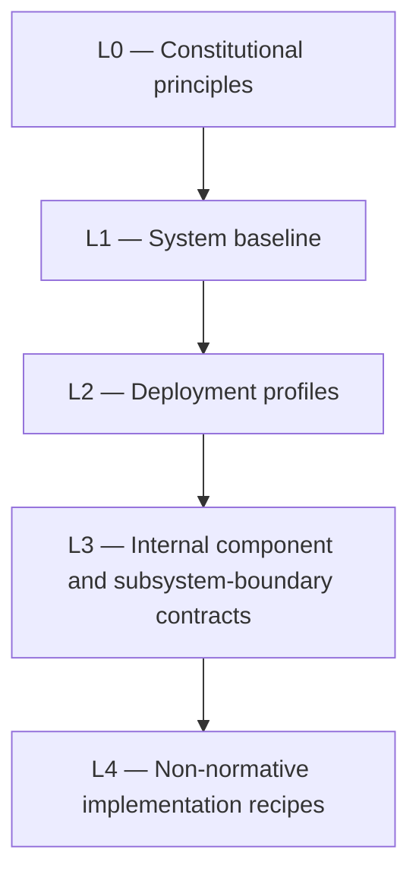

<!-- Frozen source: https://github.com/Rejean-McCormick/kOA-Linux-Koali/wiki/System-Architecture | commit: a014d6b410b475fe227e3f0153bbae6e54ef0520 | SHA-256: 008e9aa79411b259c8d86a834de7f5674e2346b78e74ae2574bf04965742e659 -->

<!-- Navigational projection. Normative authority remains in the repository docs/ corpus. -->

# System Architecture

> **Authority notice:** This wiki is a readable navigation layer. Source contracts, accepted ADRs, normative documents, and executable validators in the repository remain authoritative.

## System class

The system contract defines kOA as a local-first, offline-capable, modular operating environment for governed knowledge, coordination, language, media, navigation, publication, and sovereign deployment.

## Architectural layers

## Operating modes

| Mode | Purpose | Connectivity |
| --- | --- | --- |
| `interactive_user` | Operate the local user-facing kOA environment with deterministic core services and task-activated heavy work. | online, restricted_network, offline |
| `development` | Develop multiple kOA applications, branches, and worktrees in isolated reproducible workspaces. | online, restricted_network |
| `build` | Produce reproducible, validated, provenance-bearing system, service, governance, and knowledge artifacts. | online, restricted_network, offline_with_imported_sources |
| `service_node` | Host a persistent kOA node with profile-defined availability, security, recovery, and offline guarantees. | online, restricted_network, offline |
| `hub` | Coordinate multiple nodes, artifacts, or governed domains without replacing component or node authority. | online, restricted_network, intermittent |
| `control_plane` | Operate deployment, release, policy, and fleet coordination services for profiles that require a control plane. | online, restricted_network |
| `recovery` | Restore a valid system, artifact set, or authoritative data state without creating partial authority. | online, restricted_network, offline |

## Boundary rules

- Components do not write directly into another component or subsystem's authoritative state.
- Privileged host mutations pass through narrow, declared interfaces.
- External integrations are optional, capability-scoped, and non-authoritative.
- Profile contracts select deployment membership, resources, connectivity, and degradation behavior.
- Release and artifact identity must agree before activation.

## System documentation

- [`docs/02-system/00-system-overview.md`](../blob/main/docs/02-system/00-system-overview.md)
- [`docs/02-system/01-system-context.md`](../blob/main/docs/02-system/01-system-context.md)
- [`docs/02-system/02-logical-architecture.md`](../blob/main/docs/02-system/02-logical-architecture.md)
- [`docs/02-system/03-operating-modes.md`](../blob/main/docs/02-system/03-operating-modes.md)
- [`docs/02-system/04-component-boundaries.md`](../blob/main/docs/02-system/04-component-boundaries.md)
- [`docs/02-system/05-data-authority-and-ownership.md`](../blob/main/docs/02-system/05-data-authority-and-ownership.md)
- [`docs/02-system/06-capability-model.md`](../blob/main/docs/02-system/06-capability-model.md)
- [`docs/02-system/07-cross-component-communication.md`](../blob/main/docs/02-system/07-cross-component-communication.md)
- [`docs/02-system/08-offline-behavior.md`](../blob/main/docs/02-system/08-offline-behavior.md)
- [`docs/02-system/17-capability-degradation.md`](../blob/main/docs/02-system/17-capability-degradation.md)
- [`docs/02-system/19-release-and-artifact-identity.md`](../blob/main/docs/02-system/19-release-and-artifact-identity.md)
- [`docs/02-system/20-receipts-and-critical-transitions.md`](../blob/main/docs/02-system/20-receipts-and-critical-transitions.md)
- [`docs/contracts/system.contract.json`](../blob/main/docs/contracts/system.contract.json)
